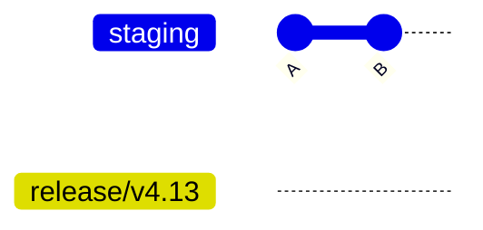
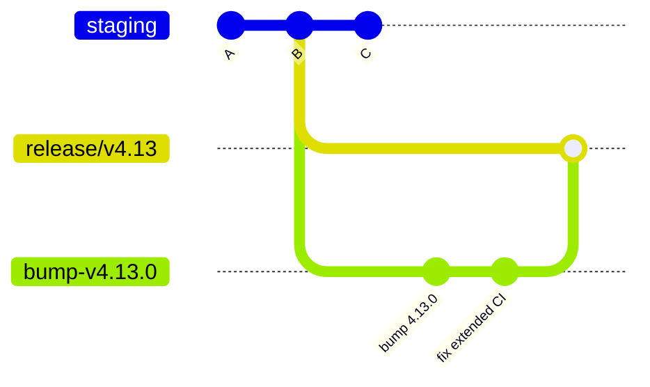
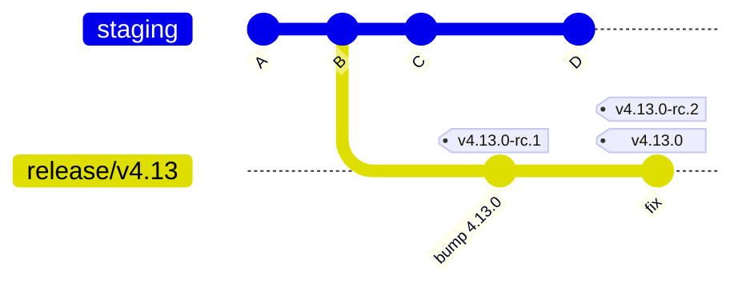
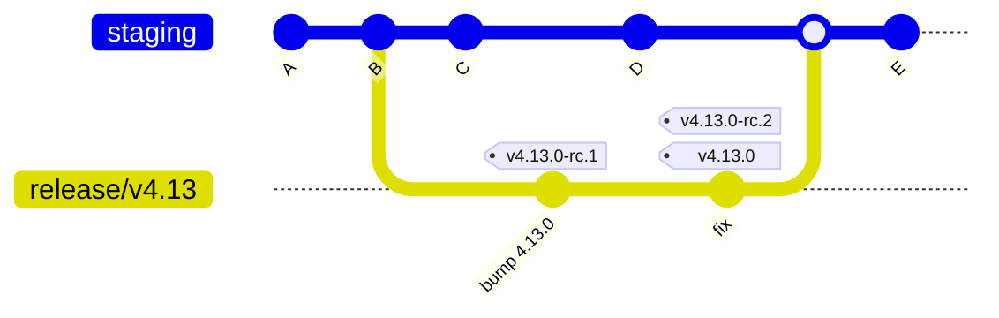
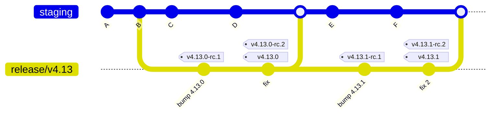

# Branching and Releasing

snarkVM uses trunk-based development. `staging` is the trunk. Each release is made on its own release branch, cut from `staging`.

## Branches

| Branch | Purpose |
| :- | :- |
| `staging` | The trunk. All feature work targets it. |
| `release/vX.Y` | One branch for each minor release, for example `release/v4.13`. Patch releases (`v4.13.1`) come from the same branch. |

The `mainnet`, `testnet` and `canary` branches are no longer updated. To build what runs on a network, check out a release tag.

## Tags and releases

| Tag | GitHub | crates.io | Network |
| :- | :- | :- | :- |
| `vX.Y.Z-rc.N` | Pre-release | Not published | testnet, through snarkOS |
| `vX.Y.Z` | Release | Published | mainnet, through snarkOS |

- Release tags are made only on release branches.
- A final tag `vX.Y.Z` goes on the same commit as the accepted release candidate. mainnet runs exactly the commit that testnet accepted.
- Never move or delete a release tag.
- Tags of the form `testnet-vX.Y.Z` come from the old process.

## CI

Pull requests that target a `release/**` branch, and pushes to a `release/**` branch, run the extended CI in addition to the normal CI. See [CI.md](CI.md).

## Release process

The example below makes the `v4.13` release.

### 1. Cut the release branch

Create `release/v4.13` at the current `staging` commit, and push it.



```bash
git fetch origin
git push origin origin/staging:refs/heads/release/v4.13
```

### 2. Bump the version

Open a pull request against `release/v4.13` that sets every crate version to `4.13.0`. This pull request runs the extended CI. Here we learn whether the extended CI passes on what `staging` contained. Push fixes to the same pull request until CI passes.

Work on `staging` continues as usual.



### 3. Tag a release candidate

When no more changes are planned, tag the head of `release/v4.13` as `v4.13.0-rc.1`. Make a GitHub pre-release from the tag. snarkOS then takes it to testnet.

If testnet finds a problem, fix it with a pull request against `release/v4.13`, and tag `v4.13.0-rc.2`. Repeat until a release candidate is accepted.


### 4. Release

When testnet accepts a release candidate, tag the same commit as `v4.13.0`. Publish the crates to crates.io. Make a GitHub release from the tag. snarkOS then takes it to mainnet.



### 5. Merge the release branch into staging

A bot opens a pull request that merges `release/v4.13` into `staging` within an hour of each change to the release branch. Merge it with a merge commit. If the merge has conflicts, see [Merging a release branch](#merging-a-release-branch).



### 6. Patch releases

For a patch release, open pull requests against `release/v4.13`. One of them bumps the version to `4.13.1`. Tag release candidates `v4.13.1-rc.1`, `v4.13.1-rc.2`, and so on, until testnet accepts one. Then tag it `v4.13.1`, publish it, and merge the release branch into `staging` again.



The next minor release, `v4.14`, gets a new branch `release/v4.14` from `staging`.

## Making changes

Before you open a pull request, decide where the change goes:

- **The release in progress needs it**, for example a bug fix: target the release branch. It reaches `staging` when the release branch merges into `staging`.
- **Otherwise**: target `staging`.

Do not open the same change against both branches. If a change on `staging` is later needed in a release, cherry-pick it onto the release branch. Expect a conflict when the release branch next merges into `staging`, because git treats the cherry-picked commit as a separate commit.

Network-specific values, such as consensus version heights, are set on the release branch. The release branch contains the height tables for every network.

## Merging a release branch

Merge a release branch into `staging` with a merge commit. Do not squash or rebase. After a merge commit, git does not consider those commits in later merges, so they cannot cause conflicts again.

[merge-into-staging.yml](.github/workflows/merge-into-staging.yml) runs every hour. For each `release/*` branch with commits that `staging` lacks, it keeps one pull request open from `ci/merge-release/vX.Y-into-staging`. It requests review from the authors and reviewers of the changes it carries.

If the merge has conflicts, the bot commits them with their markers, labels the pull request `merge-conflict`, and leaves it as a draft. Do not push the resolution to the release branch. Push it to the pull request's branch instead:

```bash
git fetch origin
git checkout ci/merge-release/v4.13-into-staging
# Resolve the conflicts, then commit.
git push origin ci/merge-release/v4.13-into-staging
```

Then remove the label and mark the pull request ready for review.

Check each merge for semantic conflicts. These are changes that git merges without a conflict but that are wrong together. In snarkVM they happen most often in consensus version tables.

If two releases are open at the same time, the bot merges each release branch into `staging`.
